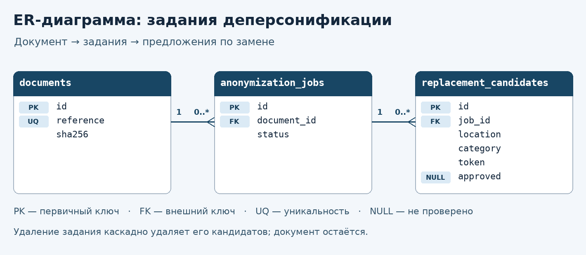

# ORM для деперсонификации электронных документов

Лабораторная работа по предмету «Командное проектирование и разработка». Это учебный прототип слоя хранения для процесса согласования замен в DOCX. Он **не обрабатывает файлы** и не сохраняет исходные персональные данные. Для демонстрации используются только синтетические данные.

Стек: Python 3.11+, SQLAlchemy 2.0, Alembic и SQLite.

## Запуск

Откройте папку клонированного проекта в IDE. На Windows в CMD:

~~~cmd
py -3 -m venv .venv
.venv\Scripts\python -m pip install -r requirements.txt
.venv\Scripts\python -m alembic upgrade head
.venv\Scripts\python -m app.demo
.venv\Scripts\python -m unittest discover -v
~~~

На Linux/macOS:

~~~sh
python3 -m venv .venv
.venv/bin/python -m pip install -r requirements.txt
.venv/bin/python -m alembic upgrade head
.venv/bin/python -m app.demo
.venv/bin/python -m unittest discover -v
~~~

По умолчанию Alembic и приложение работают с SQLite-файлом `anonymization.db`. Для проверки на отдельной БД можно задать переменную `DATABASE_URL`. Пустую БД нужно инициализировать миграцией, а не вызовом `create_all`.

## Схема

| Таблица | Что хранит | Связи |
| --- | --- | --- |
| `documents` | Уникальный технический идентификатор документа и SHA-256 его содержимого | Один документ → много заданий |
| `anonymization_jobs` | Задание, внешний ключ документа и статус `draft` / `in_review` / `completed` | Одно задание → много кандидатов |
| `replacement_candidates` | Место, категория, токен замены и решение проверки (нет / принято / отклонено) | При удалении задания удаляются его кандидаты |

Три отдельные модели лежат в `app/models`. SQLite проверяет внешние ключи, в том числе при создании задания.

## Репозиторий и миграции

`JobRepository` находится в `app/repositories/job_repository.py`. Он создаёт задания, получает задание по ID, выбирает задания одного документа по порядку ID, меняет статус и удаляет задание. Транзакцию подтверждает или откатывает вызывающий код, а не сам репозиторий. Допустимые переходы между статусами, поиск ПДн и формирование DOCX не входят в этот лабораторный прототип.

Миграция `0001` создаёт три таблицы, индексы и ограничения; `downgrade` удаляет таблицы в обратном порядке зависимостей. Команда `alembic check` сверяет актуальную БД с моделями. После изменения моделей новую ревизию можно подготовить через `alembic revision --autogenerate -m "description"`; перед применением проверьте оба направления миграции.

Тесты поднимают отдельную SQLite-БД миграцией и проверяют весь цикл CRUD, фильтрацию по документу, удаление зависимых кандидатов и невозможность создать задание для отсутствующего документа.
